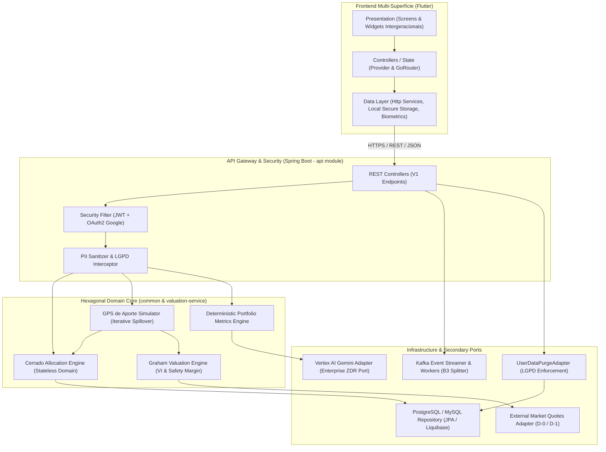
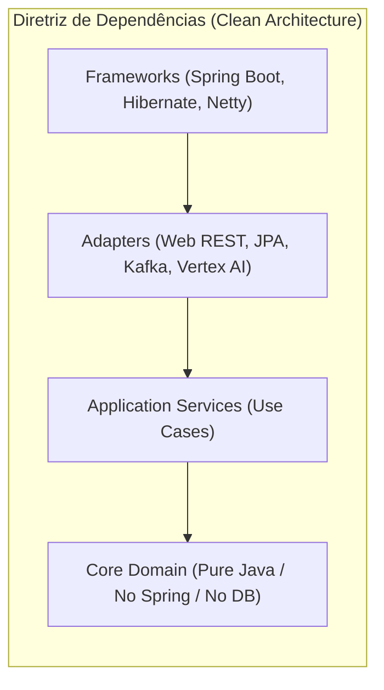
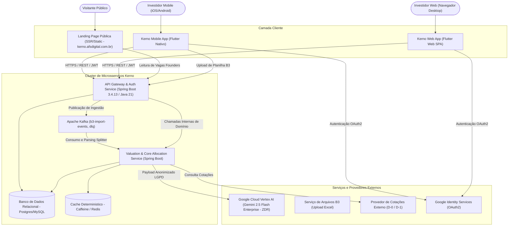
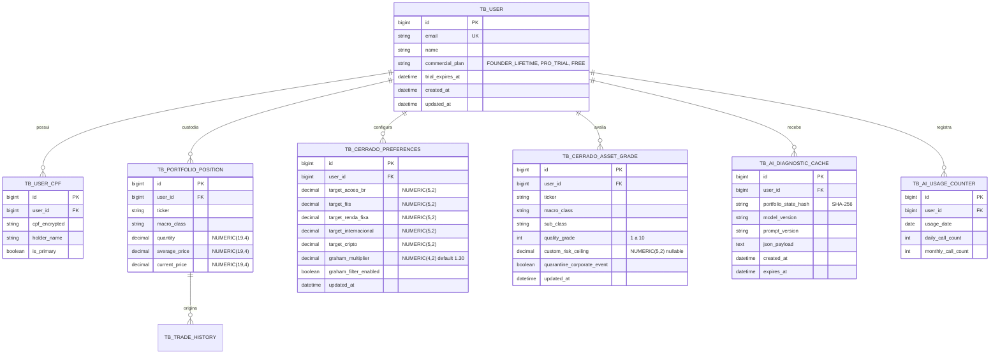

# Architecture Spine — Kerno (ex-Graham Select 2.0)

## Design Paradigm

O **Kerno** adota uma abordagem combinada para preservar o isolamento de domínio e a estabilidade brownfield:
1. **Backend (Java 21 / Spring Boot 3.4.13):** Arquitetura Hexagonal (*Ports & Adapters*) modular. O núcleo matemático (Diagrama do Cerrado, Margem de Segurança de Graham, Motor de Simulação GPS e Métricas Determinísticas) reside em serviços de domínio puros e imutáveis, desacoplados de frameworks web e persistência. Dependências externas (Google Cloud Vertex AI, B3 Ingestion, Provedores de Cotação e Notificações) são acessadas estritamente via Portas (`*Port`) implementadas por Adaptadores de Infraestrutura (`*Adapter`).
2. **Frontend (Flutter SDK ^3.11.0 / Dart 3.7+):** Arquitetura *Feature-First* orientada a camadas (`presentation`, `domain`, `data`), gerenciada via Provider + GoRouter. A aplicação é compilada como binário nativo para iOS/Android e SPA Web responsiva a partir da mesma base, com isolamento estrito de módulos de negócio (`features/portfolio`, `features/cerrado_diagram`, `features/contribution_gps`, `features/ai_analysis`, e o stub `features/expenses`).



---

## Inherited Invariants

Como evolução direta sobre a base de código estável do *Graham Select 1.0*, os seguintes invariantes brownfield são adotados como restrições vinculantes:

| Inherited | From parent | Binds here |
| --- | --- | --- |
| `AD-BROWNFIELD-1` [ADOPTED] | `architecture.md` (Legado) | Autenticação Google OAuth2 + JWT emitido pelo backend com validação por filtro de segurança em todos os endpoints `/api/v1/*` (exceto `/api/v1/public/*` e `/api/v1/founders/slots`). |
| `AD-BROWNFIELD-2` [ADOPTED] | `architecture.md` (Legado) | Pipeline de ingestão assíncrona de arquivos da B3 com padrão Splitter via Apache Kafka (`b3-import-events` e Dead Letter Queues para resiliência). |
| `AD-BROWNFIELD-3` [ADOPTED] | `AGENTS.md` (Repositório) | Imutabilidade absoluta de migrations Liquibase já aplicadas; qualquer alteração estrutural no banco de dados deve ocorrer exclusivamente via novos changesets incrementais e idempotentes. |
| `AD-BROWNFIELD-4` [ADOPTED] | `AGENTS.md` (Repositório) | Mapeamento obrigatório de todas as variáveis de ambiente e segredos em `application.yml`, Helm (`helm/graham-select/values.yaml`, `configmap.yaml`, `secret.yaml`) e `.github/workflows/deploy.yml`. |
| `AD-BROWNFIELD-5` [ADOPTED] | `AGENTS.md` (Repositório) | Logs estruturados em todas as entradas de APIs e workers assíncronos; log `ERROR` com stack trace em capturas e lançamentos de exceções. |
| `AD-BROWNFIELD-6` [ADOPTED] | `AGENTS.md` (Repositório) | Conformidade estrita ao Direito ao Esquecimento da LGPD através de integração ao `UserDataPurgeAdapter` e verificação obrigatória no teste de integração `AccountDeletionIT`. |

---

## Invariants & Rules

### AD-1 — Modelo Matemático e Motor Stateless do GPS de Aporte [ADOPTED]
- **Binds:** `FR-6`, `FR-7`, `FR-8`, `FR-17`, módulos `valuation-service`, `api` e package `features/contribution_gps`.
- **Prevents:** Persistência inútil de simulações voláteis no banco de dados, divergência de arredondamento em moedas e cotas, e quebra de regras de teto de risco em aportes simultâneos.
- **Rule:** O motor de cálculo do **GPS de Aporte** é estritamente *stateless* e executado em memória. Ele recebe: (1) o valor do aporte mensal $X > 0$, (2) o snapshot consolidado da custódia do usuário e (3) a parametrização do Diagrama do Cerrado. Todas as operações utilizam aritmética decimal estrita (`BigDecimal` com `RoundingMode.HALF_EVEN` e escala 4 em cálculos intermediários e 2 em saídas monetárias). A quantização de ativos cotados em bolsa ocorre *in-loop* gerando transbordamento (*spillover*) automático para o próximo ativo elegível da classe. O backend jamais persiste simulações de aporte no banco de dados.

### AD-2 — Parametrização e Hierarquia de 3 Níveis do Diagrama do Cerrado [ADOPTED]
- **Binds:** `FR-4`, `FR-5`, `FR-17`, tabelas do banco de dados e UI do Cerrado.
- **Prevents:** Divergência de pesos entre classes de ativos, ultrapassagem silenciosa de limites prudenciais de risco e violação do enquadramento regulatório CVM 19/20.
- **Rule:** A alocação patrimonial do usuário é estruturada em 3 níveis hierárquicos:
  1. *Nível 1 (Macro Classes):* Exatamente 5 classes (*Ações BR*, *FIIs*, *Renda Fixa / Tesouro*, *Internacional*, *Criptoativos*), cuja soma de metas percentuais deve totalizar impreterivelmente `100.00%`.
  2. *Nível 2 (Subclasses):* Enums fechados no backend (`EQUITY_DEFENSIVE`, `FII_BRICK`, `TREASURY_POST_FIXED`, etc.) com finalidade analítica.
  3. *Nível 3 (Ativo Individual):* Nota de Qualidade inteira $N_i \in [1, 10]$ atribuída pelo usuário (com default neutro `6`). Ativos com $N_i < 5$ ou em `QUARENTENA_EVENTO_CORPORATIVO` são compulsoriamente bloqueados para novos aportes no GPS ($Meta\% = 0$), sem forçar venda do patrimônio existente.
  O Teto Máximo de Risco individual é limitado por $N_i$ (8–10: 10%; 5–7: 6%; <5: 0%), com isenção restrita a títulos soberanos do Tesouro Direto e ETFs de índices amplos (`is_diversified_broad_etf = true`). O excedente de teto é redistribuído iterativamente apenas entre os ativos elegíveis da mesma Macro Classe.

### AD-3 — Pipeline Determinístico-Primeiro de IA e Anonimização LGPD (Kerno AI) [ADOPTED]
- **Binds:** `FR-9`, `FR-10`, `AiPortfolioAnalyzerPort`, `VertexAiAdapter`.
- **Prevents:** Alucinações numéricas de LLMs em relatórios financeiros, vazamento de PII (Art. 33 LGPD), custos descontrolados de inferência e enquadramento irregular de recomendação de investimentos (CVM 19/20).
- **Rule:** O serviço de IA do Kerno obedece ao padrão *Deterministic-First AI Grounding*:
  1. O backend Java consolida previamente todos os indicadores numéricos, métricas de concentração HHI, desvios e planos de aporte de forma 100% determinística.
  2. A camada `PiiSanitizer` remove 100% dos dados pessoais (CPF, nome, e-mails, IDs internos e valores absolutos em `R$`), convertendo ativos para tickers canônicos validados por allowlist ou rótulos anônimos (`RENDA_FIXA_MANUAL_1`).
  3. O provedor de IA utilizado é o **Google Cloud Vertex AI** sob contrato corporativo com cláusula mandatória de **Zero Data Retention (ZDR)** e versão pinada imutável (`gemini-2.5-flash`), com temperatura `0.1` e schema estruturado JSON restrito a 4 blocos (`resumoExecutivo`, `pontosFortes`, `alertasDeRiscoEConcentracao`, `racionalDoPlanoDeAporte`).
  4. Validação Pós-Geração: o backend inspeciona o JSON retornado verificando que (a) zero tickers ou métricas foram inventados e (b) nenhuma sentença viola o filtro léxico de modo imperativo financeiro da CVM. Qualquer falha aborta imediatamente a chamada ao LLM e ativa o fallback determinístico local com registro de log de auditoria.
  5. As respostas válidas são cacheadas (*cache-aside*) por SHA-256 do `portfolio_state_hash` com TTL de 24 horas, limitadas por rate limit estrito (5 gerações/dia, 30/mês por usuário Pro/Founder).

### AD-4 — Segurança de Sessão Mobile, Gate Biométrico e Proteção de Privacidade [ADOPTED]
- **Binds:** `FR-11`, `FR-12`, `FR-15`, package `features/portfolio` e app Flutter.
- **Prevents:** Exposição indevida de dados patrimoniais no dispositivo físico, roubo de tokens em repouso e vazamento visual no seletor de aplicativos recentes do sistema operacional.
- **Rule:**
  1. Tokens de autenticação (`access_token`, `refresh_token`) devem ser armazenados exclusivamente em armazenamento seguro do SO via `flutter_secure_storage` (iOS Keychain / Android Keystore EncryptedSharedPreferences).
  2. Desafio biométrico obrigatório (`local_auth`) na abertura do aplicativo e ao retornar do background após timeout de 2 minutos de inatividade.
  3. Modo Privacidade (*Discrete Mode*): toggle global persistido localmente que substitui valores absolutos por `R$ ••••••`, mantendo gráficos e percentuais analíticos visíveis.
  4. Proteção de Snapshot: ao transicionar para `AppLifecycleState.inactive` ou `AppLifecycleState.paused`, o app ativa imediatamente `FLAG_SECURE` no Android e overlay de máscara no iOS, impedindo gravação de tela ou captura de miniatura pelo *App Switcher*.

### AD-5 — Conformidade LGPD com Expurgo em Cascata [ADOPTED]
- **Binds:** `FR-16`, `UserDataPurgeAdapter`, `AccountDeletionIT`, todos os repositórios JPA.
- **Prevents:** Retenção ilícita de dados pessoais após solicitação de exclusão de conta, violando o Art. 18 da LGPD.
- **Rule:** A exclusão de conta do usuário desencadeia transacionalmente a purga total de:
  - Registros cadastrais e CPFs vinculados (`tb_user`, `tb_user_cpf`).
  - Histórico de trades e posições manuais (`tb_portfolio_position`, `tb_trade_history`).
  - Metas, templates e notas do Diagrama do Cerrado (`tb_cerrado_preferences`, `tb_cerrado_asset_grade`).
  - Snapshots, históricos de diagnósticos de IA e chaves de rate-limit (`tb_ai_diagnostic_cache`, `tb_ai_usage_counter`).
  - Qualquer job assíncrono Kafka em processamento para o `user_id` é cancelado imediatamente. Planilhas brutas de upload B3 continuam sendo descartadas de forma volátil após o parsing inicial.

### AD-6 — Design System Intergeracional e Acessibilidade Visual Universal [ADOPTED]
- **Binds:** `FR-2`, `DESIGN.md`, `EXPERIENCE.md`, todos os componentes Flutter de UI.
- **Prevents:** Truncamento de informações financeiras críticas em telas ampliadas, abandono por usuários 40+ e contraste insuficiente para leitura diurna.
- **Rule:**
  1. Suporte mandatório a `MediaQuery.textScalerOf(context)` de `1.0x` até `2.0x`. Truncamento por `TextOverflow.ellipsis` em valores monetários e tickers é estritamente proibido; cartões devem expandir verticalmente com reflow natural.
  2. Contraste mínimo de `4.5:1` para texto corrido e `7.0:1` (WCAG AAA) para números e alertas principais.
  3. Numerais tabulares obrigatórios (`fontVariantNumeric: 'tabular-nums'`) para alinhamento vertical de colunas financeiras.
  4. Áreas de toque mínimas de `48x48dp` para todos os controles interativos.

### AD-7 — Isolamento Modular da Feature Gastos (Ciclo 2.1) [ADOPTED]
- **Binds:** `FR-13`, package `features/expenses`, estrutura de rotas do GoRouter.
- **Prevents:** Acoplamento prematuro de código de gastos no Ciclo 2.0 ou necessidade de reescrever a arquitetura de navegação no Ciclo 2.1.
- **Rule:** A barra de navegação principal (`BottomNavigationBar` no mobile e Sidebar na web) reserva o 5º slot para **Gastos**, controlado pela feature flag `enable_expenses_module = false` no MVP. O motor do **GPS de Aporte** aceita como entrada tanto um `BigDecimal` digitado manualmente quanto uma interface genérica de provedor de saldo livre mensal (`MonthlyFreeBalanceProvider`), garantindo acoplamento zero entre os dois módulos.

### AD-8 — Governança de Configuração, Helm e CI/CD [ADOPTED]
- **Binds:** Repositório, `backend/api/src/main/resources/application.yml`, diretório `helm/graham-select/`, `.github/workflows/deploy.yml`.
- **Prevents:** Falhas de inicialização em produção por ausência de variáveis de ambiente do Vertex AI ou divergência entre ambientes dev, staging e prod.
- **Rule:** Toda propriedade adicionada ao `application.yml` (especialmente credenciais de service account, chaves do Vertex AI, quotas de rate limit e timeouts) deve ser espelhada em `helm/graham-select/values.yaml` e nos templates de `ConfigMap` e `Secret`. Nenhuma chave de API ou credencial sensível pode ser versionada em texto puro no repositório.



---

## Consistency Conventions

| Concern | Convention |
| --- | --- |
| Naming (Back-end) | Classes de serviço de domínio sufixadas com `Service` ou `Engine` (`CerradoAllocationEngine`, `ContributionGpsSimulator`). Portas sufixadas com `Port` (`AiPortfolioAnalyzerPort`). Adaptadores sufixados com `Adapter` (`VertexAiGeminiAdapter`, `UserDataPurgeAdapter`). Entidades JPA com prefixo `Jpa` ou em pacote `infra.persistence.entity` (`CerradoPreferencesEntity`). |
| Naming (Front-end) | Módulos desacoplados sob `lib/features/<feature_name>/` com subpastas `presentation`, `controllers`, `models`, `services`. Widgets de Design System prefixados conceitualmente com tokens (`KernoButton`, `KernoCard`, `KernoCurrencyField`). |
| Identificadores de Ativos | B3: uppercase `^[A-Z][A-Z0-9]{3}[0-9]{1,2}$` (ex.: `PETR4`, `HASH11`). Internacional: `^[A-Z0-9.-]{1,10}$` (ex.: `AAPL`, `IVV`). Tesouro e Cripto manuais mapeados para identificadores canônicos imutáveis. |
| Precisão Numérica | Java: `BigDecimal` com escala explícita (`RoundingMode.HALF_EVEN`). Banco: `NUMERIC(19,4)`. Dart: `double` encapsulado com formatação via `intl` (`NumberFormat.currency(locale: 'pt_BR', symbol: 'R$')`). |
| Datas e Timestamps | ISO-8601 UTC (`Instant` / `OffsetDateTime` no Java, `DateTime.toUtc()` no Dart, `TIMESTAMPTZ` / `TIMESTAMP` no banco). |
| Envelopes de Erro REST | Schema canônico `ApiErrorResponse(timestamp, status, error, message, path, correlationId, details[])`. |
| Observabilidade | Cabeçalho HTTP `X-Correlation-ID` propagado em todas as requisições, logs de entrada REST com parâmetros contextuais (sem PII), e logs `ERROR` sempre acompanhados do stack trace completo. |

---

## Stack

| Name | Version | Role / Context |
| --- | --- | --- |
| Java | 21 LTS | Runtime principal do backend |
| Spring Boot | 3.4.13 | Framework web, injeção de dependências e segurança |
| Flutter SDK | ^3.11.0 | Framework de desenvolvimento multiplataforma (Mobile e Web) |
| PostgreSQL / MySQL | PostgreSQL 16 / MySQL 8.0 | Banco de dados relacional principal |
| Liquibase | 4.29.x | Versionamento e automação de banco de dados |
| Apache Kafka | 3.8.x | Broker de mensageria assíncrona para ingestão B3 |
| Google Cloud Vertex AI | gemini-2.5-flash | Motor de IA corporativa com Zero Data Retention (ZDR) |
| Docker & Kubernetes | Docker 27.x / K8s 1.30+ | Containerização e orquestração de microsserviços |
| Helm | 3.16.x | Gerenciamento de releases e templates de infraestrutura |

---

## Structural Seed

### 1. Visão de Contêineres e Integrações do Sistema (C4 Container View)



### 2. Modelo de Dados Relacional Expandido (ERD - Ciclo 2.0)



### 3. Estrutura de Código Fonte (Árvore de Módulos)

```text
graham-select/
  backend/
    api/                                  # API Gateway, Segurança, Controladores REST
      src/main/java/afsdigital/grahamselect/api/
        controller/                       # Endpoints /api/v1 (Cerrado, GPS, AI, Founders, Auth)
        config/                           # Security, WebMvc, Swagger/OpenAPI
        interceptor/                      # CorrelationId, PiiSanitizationInterceptor
    common/                               # Entidades de Domínio, DTOs, Contratos, Portas
      src/main/java/afsdigital/grahamselect/common/
        domain/cerrado/                   # Diagrama do Cerrado (Macro Classes, Metas, Notas)
        domain/graham/                    # Graham Valuation Formulas (VI, Margem de Segurança)
        domain/gps/                       # Motor Stateless de Aporte Iterativo com Spillover
        port/in/                          # Casos de uso de entrada
        port/out/                         # Portas de saída (AiPortfolioAnalyzerPort, MarketDataPort)
    valuation-service/                    # Processamento analítico, Adapters externos, Kafka
      src/main/java/afsdigital/grahamselect/valuation/
        adapter/ai/                       # VertexAiGeminiAdapter (Google Cloud Vertex AI Enterprise)
        adapter/market/                   # B3 & External Quotes Adapters
        adapter/purge/                    # UserDataPurgeAdapter (LGPD Enforcement)
        kafka/                            # Splitter Consumer & DLQ Workers
  frontend/
    lib/
      core/
        theme/                            # Design System Intergeracional (Tokens, Typography, Colors)
        network/                          # Dio HTTP client configurado com Correlation-ID
        security/                         # Biometrics (local_auth) e Secure Storage
      features/
        portfolio/                        # Dashboard Patrimonial, Posições, Discrete Mode
        cerrado_diagram/                  # Configuração de Metas, Sliders e Autoavaliação de Notas
        contribution_gps/                 # Calculadora GPS de Aporte, Acordeão de Transparência
        ai_analysis/                      # Cartões Diagnóstico Kerno AI, Avaliação, Fallbacks
        founders/                         # Landing Page & Adesão ao Programa Founders
        expenses/                         # Stub arquitetural para Módulo de Gastos (Ciclo 2.1)
  helm/
    graham-select/                        # Chart Kubernetes (values.yaml, deployment, service)
```

---

## Capability → Architecture Map

| Capability / Area | Lives in | Governed by |
| --- | --- | --- |
| Landing Page & Founders (`FR-1`, `FR-14`, `FR-15`) | `frontend/lib/features/founders` & `backend/api/controller/FoundersController` | `AD-8`, `AD-BROWNFIELD-1` |
| Dashboard Patrimonial & Multi-Classes (`FR-2`, `FR-3`) | `frontend/lib/features/portfolio` & `backend/valuation-service` | `AD-2`, `AD-6`, `AD-BROWNFIELD-2` |
| Diagrama do Cerrado: Metas e Notas (`FR-4`, `FR-5`) | `frontend/lib/features/cerrado_diagram` & `backend/common/domain/cerrado` | `AD-2`, `AD-BROWNFIELD-3` |
| GPS de Aporte & Multiplicador Graham (`FR-6`, `FR-7`, `FR-8`) | `frontend/lib/features/contribution_gps` & `backend/common/domain/gps` | `AD-1`, `AD-2` |
| Kerno AI Diagnóstico de Carteira (`FR-9`, `FR-10`) | `frontend/lib/features/ai_analysis` & `backend/valuation/adapter/ai` | `AD-3`, `AD-5`, `AD-8` |
| Autenticação, Biometria e Modo Privacidade (`FR-11`, `FR-12`) | `frontend/lib/core/security` & `frontend/lib/features/portfolio` | `AD-4`, `AD-BROWNFIELD-1` |
| Fundação Modular para Gastos (`FR-13`) | `frontend/lib/features/expenses` & `backend/common/domain/gps` | `AD-7` |
| Expurgo LGPD e Gestão de Conta (`FR-16`) | `backend/valuation/adapter/purge` & `AccountDeletionIT` | `AD-5`, `AD-BROWNFIELD-6` |
| Quarentena e Eventos Corporativos (`FR-17`) | `backend/common/domain/cerrado` & `backend/common/domain/gps` | `AD-1`, `AD-2` |

---

## Deferred

Decisões intencionalmente postergadas para os próximos ciclos de desenvolvimento:

1. **Módulo Completo de Controle de Gastos Pessoais (Ciclo 2.1):** Modelagem de transações bancárias (Open Finance / Extrato OFX), categorização de despesas e cálculo automatizado de `Saldo Livre Mensal`. *Motivo:* Foco exclusivo na excelência em investimentos e aportes no Ciclo 2.0; o slot visual e a interface de injeção de saldo no GPS de Aporte já estão desacoplados por contrato.
2. **Copiloto Conversacional Interativo por Voz/Chat Streaming (Ciclo 2.2):** Sessões de chat contínuo com WebSockets/SSE e memória episódica do investidor. *Motivo:* Complexidade regulatória adicional perante CVM 19/20 e requisitos de streaming; o diagnóstico estático estruturado em 4 blocos atende 100% da necessidade do MVP.
3. **Execução Automática de Ordens (*Robo-Advisor* Custodiante):** Envio de boletas de compra e venda diretamente para o Home Broker via FIX Protocol / APIs de corretoras parceiras. *Motivo:* Exigência de licença de Administrador de Carteira CVM e custódia qualificada, incompatíveis com o modelo atual de software independente de apoio à decisão.
4. **Conexão Direta On-Chain / Carteiras Web3 Não-Custodiadas:** Sincronização automática de chaves públicas na rede Bitcoin ou Ethereum. *Motivo:* A consolidação via ETFs B3 ou cadastro manual em `BRL` atende de forma eficiente os usuários atuais sem a sobrecarga de gerenciar nós blockchain.
