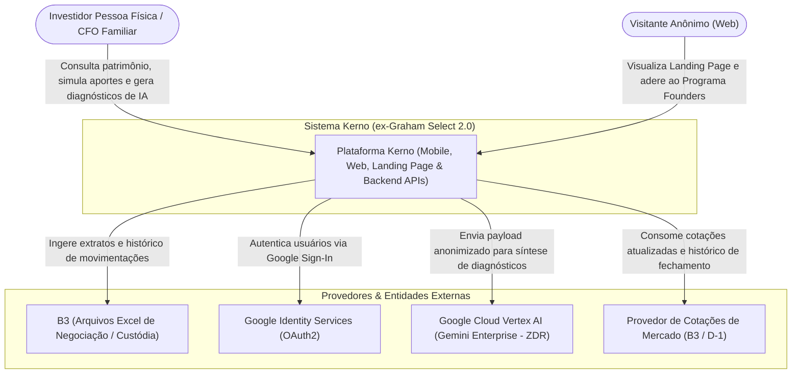
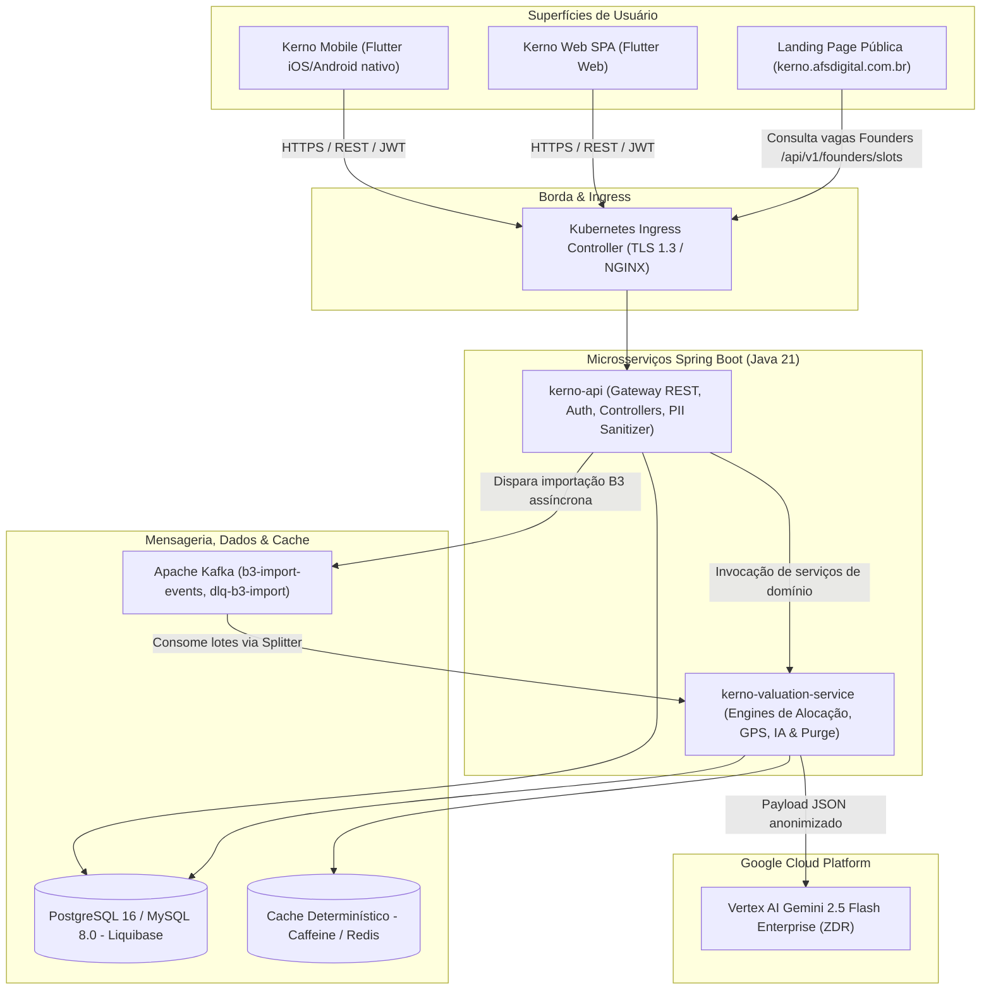
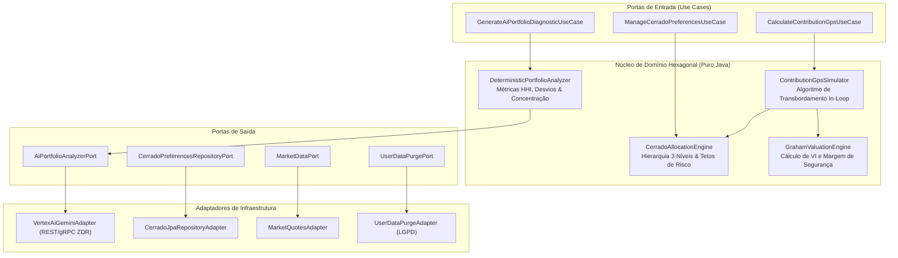
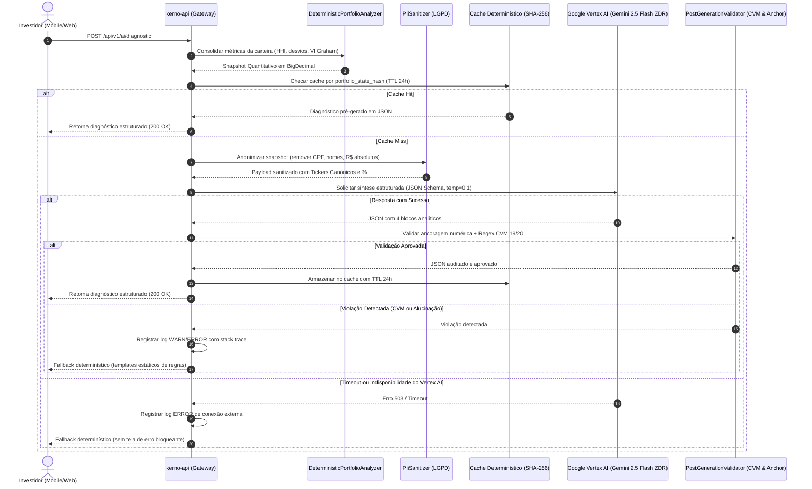

# Solution Design Document: Kerno (Ciclo 2.0)
*O núcleo inteligente do seu dinheiro — Arquitetura de Solução Técnica Completa*

**Documento:** `solution-design.md`  
**Data:** 2026-11-21  
**Autor:** Winston (System Architect 🏗️)  
**Status:** Aprovado  
**Público-Alvo:** Engenharia (Backend, Frontend/Mobile Flutter, Dados/IA, DevOps/SRE) e Liderança Técnica  

---

## 1. Visão Executiva e Contexto de Evolução

O **Kerno** representa o amadurecimento arquitetural e o rebranding estratégico do antigo *Graham Select*. Enquanto o MVP 1.0 resolveu com sucesso a ingestão de extratos da B3 e a filtragem clássica de ações por Benjamin Graham, o investidor necessitava de uma solução integrada para resolver a alocação patrimonial multissetorial sem giro de carteira (sem venda de ativos e sem DARF), acessível na palma da mão via aplicativo móvel e assistida por diagnósticos em linguagem natural com Inteligência Artificial segura e auditável.

Este documento detalha o desenho técnico da solução para o Ciclo 2.0, cobrindo:
1. **Preservação de Ativos Brownfield:** Reuso da fundação estável em Java 21 / Spring Boot 3.4.13, ingestão assíncrona Kafka e base Flutter.
2. **Novo Motor de Alocação (Diagrama do Cerrado + Graham):** Hierarquia de 3 níveis, restrições prudenciais de risco e simulador *stateless* de novos aportes (*GPS de Aporte*).
3. **Pipeline de IA Determinístico-Primeiro (*Kerno AI*):** Integração corporativa com o Google Cloud Vertex AI (Gemini 2.5 Flash Enterprise) com Zero Data Retention (ZDR), sanitização total de PII e guardrails estritos de conformidade CVM 19/20.
4. **Design System Intergeracional Multi-Superfície:** Aplicativo Flutter para iOS, Android e Web com acessibilidade motora e visual completa (WCAG 2.1 AA/AAA), numerais tabulares e biometria nativa.
5. **Conformidade LGPD e Observabilidade:** Expurgo total em cascata (`UserDataPurgeAdapter`) e rastreabilidade ponta-a-ponta via `X-Correlation-ID`.

---

## 2. Diagramas C4 (Contexto, Contêineres e Componentes)

### 2.1 C4 - Diagrama de Contexto (System Context)



### 2.2 C4 - Diagrama de Contêineres (Container Diagram)



### 2.3 C4 - Diagrama de Componentes do Módulo de Domínio (`valuation-service`)



---

## 3. Arquitetura de Domínio e Invariantes Matemáticos

### 3.1 Diagrama do Cerrado: Estrutura de Alocação e Tetos Prudenciais
A alocação de ativos no Kerno adota uma hierarquia estrita de 3 níveis:
1. **Nível 1 (Macro Classes):** 5 classes padronizadas:
   - Ações BR
   - Fundos Imobiliários (FIIs)
   - Renda Fixa / Tesouro
   - Internacional (Stocks, REITs, ETFs globais)
   - Criptoativos
   $$\sum_{C=1}^{5} \text{Meta}_C\% = 100.00\%$$
2. **Nível 2 (Subclasses Analíticas):** Segmentação analítica orientada a enums controlados pelo backend (ex.: *Ações Defensivas*, *FII Tijolo*, *Tesouro IPCA+*).
3. **Nível 3 (Ativo Individual e Nota 1 a 10):**
   - Ativo $i$ possui nota $N_i \in [1, 10]$ (padrão neutro `6`).
   - Ativos com $N_i < 5$ são considerados em **Quarentena de Aporte**: recebem meta $0\%$ para novos aportes, sem forçar venda do patrimônio atual.
   - **Teto Máximo de Risco:**
     - Nota 8–10: Teto máximo padrão de 10% do patrimônio consolidado.
     - Nota 5–7: Teto máximo padrão de 6% do patrimônio consolidado.
     - Isenção de teto: Títulos públicos do Tesouro Direto e ETFs de índices amplos (`is_diversified_broad_etf = true`, ex.: `BOVA11`, `IVVB11`, `WRLD11`).

### 3.2 GPS de Aporte: Algoritmo de Transbordamento (*Spillover*)
O motor de simulação recebe o aporte mensal $X > 0$ e distribui o capital através dos seguintes passos determinísticos:
1. **Cálculo do Patrimônio Projetado:**
   $$P_{\text{proj}} = P_{\text{atual}} + X$$
2. **Identificação de Déficits:**
   - Calcula a defasagem relativa de cada Macro Classe e de cada ativo elegível ($N_i \ge 5$).
   - Aplica o multiplicador de Graham ($M_{\text{Graham}} = 1.30$) nas Ações BR que apresentarem Margem de Segurança positiva ($\text{Preço Atual} < \text{Valor Intrínseco de Graham}$).
3. **Loop de Alocação e Quantização Inteira:**
   - Para ativos cotados em bolsa, a quantidade adquirida é calculada como $\lfloor A_{bruto} / \text{Cotação} \rfloor$.
   - O resíduo financeiro (*troco*) gerado pela quantização inteira transborda imediatamente no próprio loop para o próximo ativo elegível da fila, garantindo máxima eficiência alocativa sem reter saldo ocioso.

---

## 4. Pipeline de Inteligência Artificial Determinístico-Primeiro (*Kerno AI*)

O módulo Kerno AI foi desenhado sob o princípio de **ancoragem determinística absoluta**, eliminando riscos de alucinação e garantindo conformidade regulatória plena com a CVM (Resoluções 19 e 20) e com a LGPD (Lei 13.709/2018).



### 4.1 Guardrails de Conformidade Regulatória (CVM 19/20)
- O modelo é instruído estritamente como ferramenta analítico-educativa.
- O validador pós-geração executa filtro léxico contextualizado via regex com fronteiras de palavras (`\b`), rejeitando termos prescritivos ou exortativos (`compre agora`, `invista em`, `lucro garantido`, `vai subir`), enquanto autoriza termos descritivos neutros (`sem venda de ativos`, `preço médio de aquisição`).
- Em qualquer violação, a chamada é abortada sem retry síncrono, entregando o fallback determinístico local e registrando auditoria interna.

---

## 5. Arquitetura Multi-Superfície Flutter & Segurança Mobile

O frontend do Kerno unifica as superfícies Mobile (iOS e Android) e Web Desktop através de uma única base de código Flutter SDK (^3.11.0 / Dart 3.7+), estruturada pelo padrão *Feature-First*:

```
frontend/lib/
  ├── core/
  │    ├── theme/           # Tokens do Design System Intergeracional (DESIGN.md)
  │    ├── network/         # Cliente Dio com interceptor de X-Correlation-ID
  │    └── security/        # Integração local_auth e flutter_secure_storage
  └── features/
       ├── portfolio/       # Dashboard Patrimonial, Posições e Discrete Mode
       ├── cerrado_diagram/ # Metas das 5 Macro Classes e Notas 1-10
       ├── contribution_gps/# Calculadora Stateless e Transparência Matemática
       ├── ai_analysis/     # Cartões Kerno AI, Avaliação 👍/👎 e Fallbacks
       ├── founders/        # Landing Page e Inscrição no Programa Founders
       └── expenses/        # Stub esqueleto reservado para o Ciclo 2.1
```

### 5.1 Vetores de Segurança no Dispositivo Móvel
1. **Armazenamento de Credenciais:** `access_token` e `refresh_token` são gravados exclusivamente no Keychain (iOS) ou Keystore criptografada (Android) via `flutter_secure_storage`.
2. **Desafio Biométrico Nativo:** Utilização do `local_auth` para FaceID, TouchID ou biometria digital nativa no arranque do app ou após 2 minutos de inatividade em background.
3. **Discrete Mode (Modo Privacidade):** Toggle persistido localmente que mascara valores em reais (`R$ ••••••`) mantendo gráficos e percentuais abertos.
4. **Proteção de Snapshot Operacional:** Ativação automática de `FLAG_SECURE` (Android) e overlay de máscara (iOS) quando o app transiciona para os estados `inactive` ou `paused`, impedindo que o seletor de aplicativos recentes do SO registre capturas de tela com dados patrimoniais.

---

## 6. Governança de Dados, Migrations Liquibase e Expurgo LGPD

### 6.1 Imutabilidade Liquibase
Em estrita conformidade com a regra de governança do repositório, os arquivos de migration existentes (`backend/api/src/main/resources/db/changelog/`) permanecem intocados. As novas tabelas do Ciclo 2.0 são introduzidas via novos changesets sequenciais idempotentes:
- `db.changelog-2.0-cerrado.xml`: Criação de `tb_cerrado_preferences` e `tb_cerrado_asset_grade`.
- `db.changelog-2.0-ai-cache.xml`: Criação de `tb_ai_diagnostic_cache` e `tb_ai_usage_counter`.
- `db.changelog-2.0-founders.xml`: Adição do campo `commercial_plan` e `trial_expires_at` em `tb_user`.

### 6.2 Expurgo LGPD em Cascata (`UserDataPurgeAdapter`)
Para garantir o cumprimento pleno do Direito ao Esquecimento (Art. 18, VI da LGPD):
- O componente `UserDataPurgeAdapter` orquestra a exclusão transacional de todos os registros atrelados ao `user_id`.
- Se houver workers de importação da B3 em execução para o usuário no Kafka, os jobs são cancelados e descartados.
- A exclusão integral é permanentemente validada através da suíte de teste de integração `AccountDeletionIT`.

---

## 7. Infraestrutura, Kubernetes, Helm e Observabilidade

### 7.1 Mapeamento Helm e Paridade de Ambientes
Todas as configurações necessárias para suportar os novos recursos são declaradas e espelhadas nos manifestos Helm (`helm/graham-select/`):
- `AI_VERTEX_PROJECT_ID`: Projeto Google Cloud.
- `AI_VERTEX_LOCATION`: Região de execução (ex.: `southamerica-east1` ou `us-central1`).
- `AI_VERTEX_MODEL_NAME`: Nome pinado do modelo (`gemini-2.5-flash`).
- `AI_DAILY_RATE_LIMIT`: Limite diário por usuário (`5`).
- `AI_MONTHLY_RATE_LIMIT`: Limite mensal por usuário (`30`).
- `ENABLE_EXPENSES_MODULE`: Feature flag do módulo de gastos (`false` no Ciclo 2.0).

### 7.2 Observabilidade e Rastreabilidade
- **Correlation ID:** O cliente Flutter gera um UUID `X-Correlation-ID` que trafega por todos os microsserviços e cabeçalhos Kafka, constando nos logs estruturados.
- **Auditoria de Erros:** Exceções em qualquer camada disparam logs no nível `ERROR` acompanhados do stack trace completo, viabilizando monitoramento proativo via Grafana / ELK Stack.

---

## 8. Estratégia de Rollout e Programa Founders (250 Vagas)

1. **Janela de Lançamento Founders:**
   - Primeiros 250 investidores que autenticarem na Landing Page pública (`kerno.afsdigital.com.br`) recebem automaticamente o status `commercial_plan = FOUNDER_LIFETIME`.
   - O contador de vagas restantes é servido de forma pública e atômica pelo endpoint `/api/v1/founders/slots`.
2. **Transição Suave de Marca:**
   - O domínio público é chaveado para `kerno.afsdigital.com.br`.
   - Nomes de recursos internos de infraestrutura (nomes de pods, serviços Kubernetes e caminho `helm/graham-select/`) são preservados para garantir zero interrupção nos deploys contínuos do GitHub Actions.
